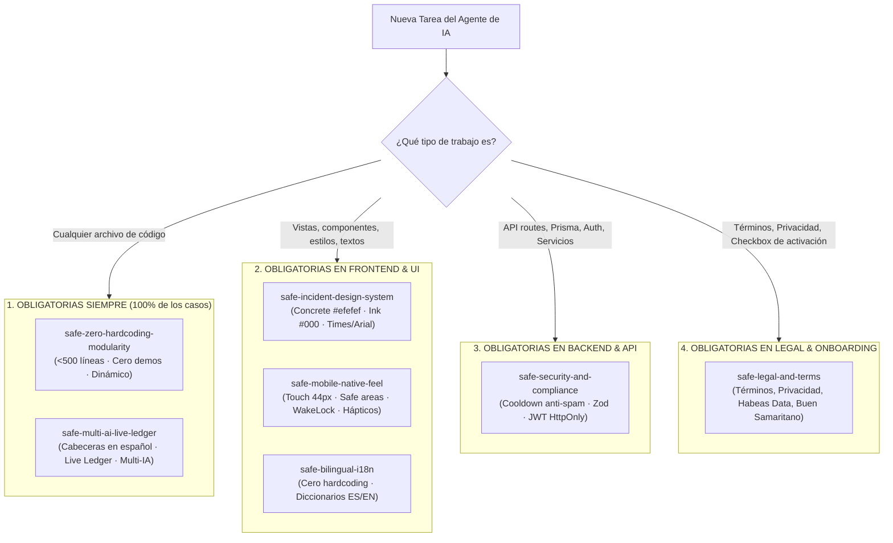

# SAFE — Manifiesto Maestro de Skills y Matriz de Activación para Agentes de IA
> **Directorio Central de Capacidades, Prioridades de Decisión y Reglas de Obligatoriedad**  
> **Versión:** 1.0 (Edición 2026) | **Gobernanza:** Concurrencia Multi-IA | **Proyecto:** SAFE

Este documento es la **guía padre de referencia rápida** para cualquier agente de Inteligencia Artificial que trabaje en el repositorio **SAFE**. Antes de ejecutar cualquier tarea, la IA debe consultar esta matriz para saber qué skills aplican a su labor.

---

## 1. Clasificación de Obligatoriedad de las Skills

---

## 2. Matriz Detallada de Skills

### 🔴 NIVEL 1: SKILLS OBLIGATORIAS SIEMPRE (Innegociables para Cualquier Tarea)

Estas 2 skills deben obedecerse en **el 100% de las intervenciones**, sin importar si se toca una línea de backend, un archivo de configuración, una base de datos o un componente visual.

| Skill | Ubicación | Cuándo se Activa | Mandato Principal |
| :--- | :--- | :--- | :--- |
| **`safe-zero-hardcoding-modularity`** | [SKILL.md](file:///c:/Users/HP/OneDrive/Desktop/safe/.agents/skills/safe-zero-hardcoding-modularity/SKILL.md) | **SIEMPRE (100% de las tareas)** | • **Límite máximo de 500 líneas físicas** por archivo. • **CERO datos mock o demos hardcodeadas**; todo debe leerse y guardarse dinámicamente en PostgreSQL, Cloudinary y Gmail SMTP. • Código de producción completo sin `// TODO` ni elipsis. |
| **`safe-multi-ai-live-ledger`** | [SKILL.md](file:///c:/Users/HP/OneDrive/Desktop/safe/.agents/skills/safe-multi-ai-live-ledger/SKILL.md) | **SIEMPRE (100% de las tareas)** | • **Cabecera obligatoria en español** al inicio de cada archivo declarando propósito y reglas. • **Comentarios en español** en cada función y endpoint. • **Actualización obligatoria de `docs/LIVE_ARCHITECTURE_LEDGER.md`** al terminar cada cambio. • **Prohibido sobreescribir código de otra IA** sin registrar solicitud formal. • **Verificación automatizada obligatoria** (`tsc --noEmit` / `build`). |

---

### 🟡 NIVEL 2: SKILLS OBLIGATORIAS PARA FRONTEND, VISTAS Y DISEÑO

Se activan en cualquier tarea que cree o modifique archivos dentro de `src/app/`, `src/components/`, `src/hooks/`, `src/locales/` o `src/app/globals.css`.

| Skill | Ubicación | Cuándo se Activa | Mandato Principal |
| :--- | :--- | :--- | :--- |
| **`safe-incident-design-system`** | [SKILL.md](file:///c:/Users/HP/OneDrive/Desktop/safe/.agents/skills/safe-incident-design-system/SKILL.md) | Al maquetar o estilizar cualquier interfaz visual | • Estética *Technical broadsheet on concrete*. • Lienzo de página `#efefef` (Concrete), tarjetas `#ffffff` (Paper), texto y bordes `#000000` (Ink), baliza de marca `#f25533` (Signal Orange). • Tipografía: **Times (serif)** para lectura y titulares; **Arial 13px** para microetiquetas y botones. • Botones neutros en concreto con borde negro capilar de 1px y radio 4px. • **CERO GRADIENTES** y sombras ultraligeras al 2-4%. |
| **`safe-mobile-native-feel`** | [SKILL.md](file:///c:/Users/HP/OneDrive/Desktop/safe/.agents/skills/safe-mobile-native-feel/SKILL.md) | Al diseñar experiencias móviles, PWA y Modo Ruta | • Objetivos táctiles mínimos de **44x44px**. • Adaptación a muescas y gestos con `safe-area-insets`. • Vibración háptica con `navigator.vibrate` en escaneos y acciones críticas. • Hojas inferiores modales (*bottom sheets*) para acciones móviles. • **Screen WakeLock API** (`navigator.wakeLock`) para evitar que el móvil duerma el GPS en Modo Ruta. • Modo PWA Standalone y alto contraste solar en la vista de emergencia. |
| **`safe-bilingual-i18n`** | [SKILL.md](file:///c:/Users/HP/OneDrive/Desktop/safe/.agents/skills/safe-bilingual-i18n/SKILL.md) | Al escribir cualquier texto, botón, título o correo | • **CERO textos en duro (`hardcoded`) en el código.** • Todo texto se obtiene de `src/locales/` (`es.ts` y `en.ts`). • Selector de idioma instantáneo en la cabecera. • Correos y mensajes de WhatsApp con coordenadas DMS y enlace de Google Maps generados bilingües. • **Lenguaje humano y empático (Cero jerga técnica o stack-babble en UI).** |

---

### 🔵 NIVEL 3: SKILLS OBLIGATORIAS PARA BACKEND, SEGURIDAD Y BASE DE DATOS

Se activan en cualquier tarea que intervenga `src/app/api/`, `src/services/`, `src/lib/` o `prisma/`.

| Skill | Ubicación | Cuándo se Activa | Mandato Principal |
| :--- | :--- | :--- | :--- |
| **`safe-security-and-compliance`** | [SKILL.md](file:///c:/Users/HP/OneDrive/Desktop/safe/.agents/skills/safe-security-and-compliance/SKILL.md) | Al crear o modificar API routes, autenticación o despacho de alertas | • **Escudo anti-spam y cooldown de 3 minutos** por dispositivo en `/api/emergency/alert` con excepción por desplazamiento >150m. • Protección anti-fuerza bruta en PIN de 6 dígitos. • Cookies de sesión `HttpOnly` firmadas con JWT (`jose`). • Validación estricta con esquemas Zod en todas las peticiones. • Ofuscación de cédula/ID médico en la vista pública de emergencia. |

---

### 🟢 NIVEL 4: SKILLS CONDICIONALES PARA MÓDULO LEGAL Y ONBOARDING

Se activan al trabajar en las páginas de políticas o en el formulario de registro del kit.

| Skill | Ubicación | Cuándo se Activa | Mandato Principal |
| :--- | :--- | :--- | :--- |
| **`safe-legal-and-terms`** | [SKILL.md](file:///c:/Users/HP/OneDrive/Desktop/safe/.agents/skills/safe-legal-and-terms/SKILL.md) | Al construir o editar `/terms`, `/privacy` o `/activate/[code]` | • Páginas legales reales en Español e Inglés. • Cláusulas de consentimiento médico expreso (Habeas Data / GDPR). • Exención de responsabilidad del Buen Samaritano para paramédicos y testigos. • Consentimiento de geolocalización en tiempo real. • **Casilla de verificación obligatoria** antes de permitir la activación del kit. |

---

## 3. Protocolo de Decisión Rápida para una Nueva IA (Paso a Paso)

Cuando una nueva IA se incorpore al proyecto, debe seguir obligatoriamente este algoritmo de 4 pasos:

1. **Paso 1: Leer el Registro Vivo**
   - Abrir y leer [`docs/LIVE_ARCHITECTURE_LEDGER.md`](file:///c:/Users/HP/OneDrive/Desktop/safe/docs/LIVE_ARCHITECTURE_LEDGER.md) para conocer el estado actual, las dependencias disponibles, los bloqueos activos de otras IAs y las firmas de los endpoints.
2. **Paso 2: Aplicar las Skills Obligatorias Siempre (Nivel 1)**
   - Activar [`safe-zero-hardcoding-modularity`](file:///c:/Users/HP/OneDrive/Desktop/safe/.agents/skills/safe-zero-hardcoding-modularity/SKILL.md) (vigilar límite de 500 líneas y dinamismo total).
   - Activar [`safe-multi-ai-live-ledger`](file:///c:/Users/HP/OneDrive/Desktop/safe/.agents/skills/safe-multi-ai-live-ledger/SKILL.md) (añadir cabeceras en español y preparar registro).
3. **Paso 3: Identificar y Cargar las Skills de Dominio (Nivel 2, 3 o 4)**
   - Si es **UI / Visual:** Cargar [`safe-incident-design-system`](file:///c:/Users/HP/OneDrive/Desktop/safe/.agents/skills/safe-incident-design-system/SKILL.md), [`safe-mobile-native-feel`](file:///c:/Users/HP/OneDrive/Desktop/safe/.agents/skills/safe-mobile-native-feel/SKILL.md) y [`safe-bilingual-i18n`](file:///c:/Users/HP/OneDrive/Desktop/safe/.agents/skills/safe-bilingual-i18n/SKILL.md).
   - Si es **Backend / API / BD:** Cargar [`safe-security-and-compliance`](file:///c:/Users/HP/OneDrive/Desktop/safe/.agents/skills/safe-security-and-compliance/SKILL.md).
   - Si es **Legal / Onboarding:** Cargar [`safe-legal-and-terms`](file:///c:/Users/HP/OneDrive/Desktop/safe/.agents/skills/safe-legal-and-terms/SKILL.md).
4. **Paso 4: Verificación y Asentamiento en el Ledger Vivo**
   - Ejecutar verificación automatizada (`tsc --noEmit` o `build`).
   - Actualizar [`docs/LIVE_ARCHITECTURE_LEDGER.md`](file:///c:/Users/HP/OneDrive/Desktop/safe/docs/LIVE_ARCHITECTURE_LEDGER.md) con los archivos creados/modificados, líneas exactas y resultado de la prueba.
