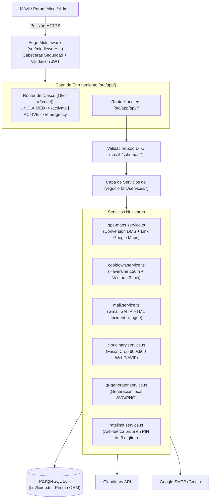

# SAFE — Arquitectura Integral de Backend (Edición 2026)
> **Emergency Medical & Real-Time GPS Ledger for Riders**  
> **Runtime:** Node.js v24+ · Next.js 15 (App Router / Route Handlers) · TypeScript 5.6+  
> **Patrón Arquitectónico:** Arquitectura en Capas desacoplada (Edge Middleware → Route Handlers → Zod Schemas → Services → Prisma ORM)  
> **Regla de Ingeniería:** Límite estricto < 500 líneas físicas por archivo · Cero mocks · Comentarios en Español.

---

## 1. Visión General y Topología del Backend

El backend de **SAFE** es un motor monolítico de alto rendimiento concebido para responder en menos de **80 milisegundos** a eventos críticos de emergencia vial. Se ejecuta sobre Route Handlers nativos de Next.js 15 en `src/app/api/`, organizados bajo el principio de responsabilidad única (SRP), con tipado estricto de extremo a extremo, validación preventiva mediante **Zod**, y despacho asíncrono de alertas con enlaces directos a **Google Maps Oficial**.



---

## 2. Estructura Exhaustiva de Directorios del Backend

```text
src/
├── middleware.ts                             # Protección de rutas privadas (/dashboard, /admin) y cabeceras
├── app/
│   ├── r/
│   │   └── [code]/route.ts (o page.tsx)      # Gateway inteligente del casco: bifurca UNCLAIMED vs ACTIVE
│   └── api/
│       ├── auth/
│       │   ├── login/route.ts                # POST Login con contraseña + Cookie JWT HttpOnly
│       │   └── logout/route.ts               # POST Expiración inmediata de sesión
│       ├── devices/
│       │   └── activate/route.ts             # POST Activación con PIN + Transacción User/Profile + Auto-Login
│       ├── emergency/
│       │   └── alert/route.ts                # POST Captura GPS + Cooldown + Despacho Gmail masivo
│       ├── gps/
│       │   └── heartbeat/route.ts            # POST Coordenada en vivo del Modo Ruta en carretera
│       ├── profile/
│       │   └── route.ts                      # GET/PUT Consulta y edición médica + contactos ilimitados
│       ├── upload/
│       │   └── cloudinary/route.ts           # POST Subida de fotografía con firma segura
│       └── admin/
│           ├── batches/route.ts              # GET/POST Generación de lotes y folios secuenciales
│           └── encode-nfc/route.ts           # PATCH Confirmación de grabación física NFC
├── services/
│   ├── gps-maps.service.ts                   # Conversión sexagesimal DMS y URL oficial Google Maps
│   ├── cooldown.service.ts                   # Algoritmo Haversine y control anti-spam de 3 minutos
│   ├── mail.service.ts                       # Cliente Nodemailer SMTP y plantilla HTML bilingüe Incident
│   ├── cloudinary.service.ts                 # SDK Cloudinary v2 centrado en rostro (600x600)
│   ├── qr-generator.service.ts               # Renderizador local de códigos QR en memoria
│   └── ratelimit.service.ts                  # Control de fuerza bruta en PIN y login (Sliding Window)
├── lib/
│   ├── env.ts                                # Validación en tiempo de arranque de variables .env con Zod
│   ├── db.ts                                 # PrismaClient Singleton con logging estructurado
│   ├── auth.ts                               # Firmado y verificación de JWT con jose (HS256)
│   ├── api-response.ts                       # Helpers estandarizados de respuestas JSON (success, error)
│   └── schemas/
│       ├── activate.schema.ts                # Esquema Zod de activación de kit
│       ├── emergency.schema.ts               # Esquema Zod de alerta de emergencia
│       ├── profile.schema.ts                 # Esquema Zod de perfil médico
│       └── admin.schema.ts                   # Esquema Zod de lotes y codificación NFC
└── locales/                                  # Diccionarios bilingües ES / EN sin hardcoding
```

---

## 3. Gateway Inteligente del Casco (`/r/[code]`)

Es el punto de entrada al que apunta la URL grabada en el chip NFC y en el código QR (`https://dominio.com/r/SAFE-0001?v=nfc`).
* **Lógica de Bifurcación Innegociable:**
  1. Sanitiza el parámetro: `code = code.toUpperCase().trim()`.
  2. Consulta la base de datos: `db.device.findUnique({ where: { code } })`.
  3. Si el dispositivo no existe o tiene `status === 'DISABLED'`, responde con vista de aviso de chip inactivo (HTTP 404).
  4. Si `status === 'UNCLAIMED'` o no tiene `userId`:
     - Redirige con código HTTP 307 a `/activate/[code]`.
  5. Si `status === 'ACTIVE'`:
     - **Sin excepciones:** Redirige con código HTTP 307 directamente a `/emergency/[code]?v=nfc|qr`. Nunca muestra formularios de login ni configuraciones.

---

## 4. Catálogo Detallado de Endpoints API (`/api/*`)

### 4.1. `POST /api/devices/activate`
* **Propósito:** Activa un kit virgen (`UNCLAIMED`), crea la cuenta del motociclista, guarda el perfil médico inicial y autentica automáticamente la sesión.
* **Seguridad:** Pública con protección anti-fuerza bruta (máximo 5 intentos de PIN por IP/folio cada 15 min).
* **Entrada (Zod Schema - `ActivateDeviceSchema`):**
  - `code`: string (4-20 chars, regex `/^[A-Z0-9-]+$/`).
  - `activationPin`: string numérico de exactamente 6 dígitos.
  - `email`: string email válido RFC 5322.
  - `password`: string (mínimo 8 caracteres).
  - `fullName`: string (3-100 chars).
  - `nationalId`: string (5-30 chars).
  - `photoUrl`: string URL válida de Cloudinary.
  - `photoPublicId`: string opcional.
  - `bloodType`: enum (`O+`, `O-`, `A+`, `A-`, `B+`, `B-`, `AB+`, `AB-`, `DESCONOCIDO`).
  - `allergies`, `chronicConditions`, `medications`: strings descriptivos.
  - `insuranceInfo`: string opcional.
  - `emergencyContacts`: array de mínimo 1 contacto (`id`, `name`, `relation`, `phone`, `email`).
  - `termsAccepted`: literal booleano `true` (consentimiento legal vinculante).
* **Transacción Atómica de Base de Datos (`prisma.$transaction`):**
  1. Bloqueo optimista: verifica que `Device.code == code` y `Device.status == UNCLAIMED`.
  2. Compara `Device.activationPin == activationPin`.
  3. Hashea la contraseña con `bcryptjs.hash(password, 12)`.
  4. Inserta el registro `User`.
  5. Inserta el registro `MedicalProfile` vinculado al usuario.
  6. Actualiza `Device.status = ACTIVE`, vincula `userId` y marca `activatedAt = now()`.
* **Respuesta Exitosa (HTTP 201):**
  - Inyecta Cookie `safe_session=<JWT>; HttpOnly; Secure; SameSite=Lax; Path=/; Max-Age=2592000` (30 días).
  - Body: `{ success: true, redirect: "/dashboard" }`.

---

### 4.2. `POST /api/emergency/alert`
* **Propósito:** Endpoint de máxima prioridad. Recibe la coordenada GPS del escaneo del casco, evalúa la ventana de cooldown anti-spam, guarda la alerta y despacha correos Gmail con enlace a Google Maps a los contactos registrados.
* **Seguridad:** Pública. Protegida con ventana de cooldown por dispositivo.
* **Entrada (Zod Schema - `EmergencyAlertSchema`):**
  - `code`: string (código del casco escaneado).
  - `latitude`: number (-90 a 90).
  - `longitude`: number (-180 a 180).
  - `scanSource`: enum (`"nfc"` | `"qr"` | `"direct"`).
  - `accuracy`: number opcional (precisión en metros reportada por el sensor del móvil).
* **Lógica del Algoritmo Anti-Spam Cooldown (`cooldown.service.ts`):**
  1. Consulta `Device` por `code` con inclusión de `MedicalProfile` y última alerta `EmergencyAlert`.
  2. Si `status !== ACTIVE`, rechaza con HTTP 400.
  3. Compara `now()` contra `device.lastAlertAt`:
     - Si han pasado **menos de 3 minutos** (180 seg):
       - Calcula distancia con Haversine entre `(latitude, longitude)` y la última alerta.
       - Si distancia **< 150 metros**: Se registra la alerta en BD con `wasThrottled = true` y `emailsSentCount = 0`. **No se envía correo** para no saturar SMTP ni aterrorizar a la familia. Retorna HTTP 200 con `{ wasThrottled: true }`.
       - Si distancia **>= 150 metros**: Se asume traslado (ambulancia/patrulla). Se permite el envío.
  4. Si pasaron más de 3 minutos o hubo traslado:
     - Convierte `(latitude, longitude)` a formato sexagesimal DMS (`gps-maps.service.ts`).
     - Construye URL oficial de Google Maps con pin exacto.
     - Guarda `EmergencyAlert` con `wasThrottled = false`.
     - Actualiza `Device.lastAlertAt = now()`.
     - Invoca `mail.service.ts` para enviar correo HTML bilingüe en paralelo a todos los contactos del `MedicalProfile`.
     - Actualiza `emailsSentCount` con el número de correos entregados.
* **Respuesta Exitosa (HTTP 200):**
  - `{ success: true, alertId: string, dmsFormatted: string, googleMapsUrl: string, emailsSentCount: number, wasThrottled: boolean }`.

---

### 4.3. `POST /api/gps/heartbeat`
* **Propósito:** Registra la posición en vivo del motociclista cada 15-30 segundos mientras rueda con el *Modo Ruta* encendido.
* **Seguridad:** Privada. Requiere cookie `safe_session` válida con rol `RIDER`.
* **Entrada:** `{ lat: number, lng: number }`.
* **Lógica:** Actualiza `User.lastKnownLat`, `User.lastKnownLng`, `User.lastGpsAt = now()`, y asegura `User.liveRideActive = true`.
* **Respuesta (HTTP 200):** `{ success: true, recordedAt: string }`.

---

### 4.4. `POST /api/auth/login` y `POST /api/auth/logout`
* **Login:** Valida credenciales contra `User.passwordHash` usando `bcryptjs.compare()`. Si es válido, genera JWT firmado con `jose` y lo inyecta en cookie `HttpOnly`.
* **Logout:** Sobrescribe la cookie `safe_session` con `Max-Age=0` y expira la sesión de inmediato.

---

### 4.5. `GET /api/profile` y `PUT /api/profile`
* **GET:** Devuelve la ficha médica y el array JSON de contactos del usuario autenticado.
* **PUT:** Valida campos con `ProfileUpdateSchema`, actualiza `MedicalProfile` en PostgreSQL y sincroniza modificaciones de contactos.

---

### 4.6. `GET /api/admin/batches` y `POST /api/admin/batches`
* **Seguridad:** Requiere cabecera `x-admin-key: process.env.ADMIN_MASTER_KEY` o sesión de rol `ADMIN`.
* **POST (Generar Lote):**
  - Entrada: `{ batchName: string, quantity: number }` (cantidad entre 1 y 100 por lote).
  - Lógica: En una transacción, consulta el último folio existente (`SAFE-XXXX`), genera códigos secuenciales únicos (`SAFE-0001`, `SAFE-0002`...), genera un `activationPin` criptográfico de 6 dígitos (`crypto.randomInt(100000, 999999)`) por cada uno, y los inserta en `Device` con `status = UNCLAIMED`.
  - Retorna la lista de dispositivos creados para impresión de tarjetas y grabado NFC.

---

### 4.7. `PATCH /api/admin/encode-nfc`
* **Propósito:** Confirmar que el Administrador grabó físicamente el sticker NFC en la tira móvil.
* **Entrada:** `{ code: string, nfcSerialNumber: string, isLockedReadOnly: boolean }`.
* **Lógica:** Actualiza `Device.nfcSerialNumber`, `Device.isNfcEncoded = true`, `Device.isLockedReadOnly`, `Device.encodedAt = now()`.

---

### 4.8. `POST /api/upload/cloudinary`
* **Propósito:** Endpoint de subida de imágenes con validación de tipo MIME y tamaño máximo (5MB).
* **Entrada:** FormData o payload Base64 Data URI (`data:image/...`).
* **Lógica:** Invoca `uploadRiderPhotoToCloudinary(base64, deviceCode)` y retorna `{ photoUrl, photoPublicId }`.

---

## 5. Servicios Nucleares de Negocio

### 5.1. Conversor Geográfico sexagesimal DMS (`src/services/gps-maps.service.ts`)
Convierte grados decimales (`Float`) a nomenclatura sexagesimal exacta de alta precisión técnica:
- **Fórmula:** Grados enteros + Minutos (`(frac * 60)`) + Segundos con un decimal (`((fracMin) * 60).toFixed(1)`).
- **Construcción URL Oficial Google Maps:**
  `https://www.google.com/maps/place/<DMS_ENCODED>/@<LAT>,<LNG>,744m/data=!3m2!1e3!4b1!4m4!3m3!8m2!3d<LAT>!4d<LNG>`
- **Generación de Mensaje Directo para WhatsApp:** Texto pre-armado con formato negrita, baliza de emergencia y salto de línea listo para compartir en 1 toque.

### 5.2. Escudo Anti-Spam y Haversine (`src/services/cooldown.service.ts`)
Calcula la distancia geodésica ortodrómica sobre la esfera terrestre entre dos puntos:
$$\Delta\sigma = 2 \cdot \arcsin\left(\sqrt{\sin^2\left(\frac{\Delta\phi}{2}\right) + \cos(\phi_1)\cos(\phi_2)\sin^2\left(\frac{\Delta\lambda}{2}\right)}\right)$$
$$\text{distancia} = R \cdot \Delta\sigma \quad (\text{con } R = 6.371.000 \text{ metros})$$
Determina si la nueva alerta excede el umbral de 150 metros para permitir el bypass de la ventana de cooldown de 3 minutos.

### 5.3. Motor de Despacho SMTP Gmail Bilingüe (`src/services/mail.service.ts`)
* Utiliza Nodemailer conectado a `smtp.gmail.com:465` con SSL directo.
* Plantilla HTML con sistema de diseño **Incident**:
  - Encabezado con franja en concreto (`#efefef`) y baliza en Signal Orange (`#f25533`).
  - Titular en Times New Roman serif, 24px, peso 700.
  - Tabla de datos de emergencia: Nombre del piloto, Tipo de Sangre, Coordenada DMS.
  - Botón neutro enmarcado con borde negro de 1px: **"ABRIR UBICACIÓN EXACTA EN GOOGLE MAPS"**.
  - Versión bilingüe español e inglés en el mismo correo para comprensión inmediata.

### 5.4. Adaptador de Fotos Cloudinary (`src/services/cloudinary.service.ts`)
* Valida tamaño máximo de imagen (máximo 5MB).
* Aplica transformación en el servidor de Cloudinary:
  `{ width: 600, height: 600, crop: "fill", gravity: "face", quality: "auto:good", fetch_format: "auto" }`.
* Guarda `secure_url` y `public_id` para permitir actualización sin dejar archivos huérfanos.

### 5.5. Generador Local de Códigos QR (`src/services/qr-generator.service.ts`)
* Utiliza la librería `qrcode` para generar representaciones vectoriales en SVG y DataURL Base64 de alta resolución en memoria.
* Cero peticiones a APIs externas de generación de códigos QR (autonomía total y velocidad instantánea).

---

## 6. Seguridad, Middleware y Gestión de Sesiones

### 6.1. Edge Middleware (`src/middleware.ts`)
* Intercepta peticiones entrantes:
  - Rutas `/dashboard/*`: Verifica token `safe_session`. Si no existe o expiró, redirige a `/login?redirect=...`.
  - Rutas `/admin/*`: Verifica que el usuario tenga rol `ADMIN` o que la cabecera `x-admin-key` coincida con `ADMIN_MASTER_KEY`.
* Inyección de Cabeceras de Seguridad:
  - `X-Frame-Options: DENY` (Anti-Clickjacking).
  - `X-Content-Type-Options: nosniff` (Anti-MIME sniffing).
  - `Referrer-Policy: strict-origin-when-cross-origin`.
  - `Permissions-Policy: geolocation=(self)`.

### 6.2. Criptografía y JWT (`src/lib/auth.ts`)
* **Algoritmo de Firma:** `HS256` utilizando la librería `jose` (nativa en Edge/Node runtime, sin dependencias OpenSSL legacy).
* **Payload JWT:** `{ sub: userId, role: Role, email: string, iat: number, exp: number }`.
* **Cookie Flags:** `HttpOnly: true`, `Secure: true` (en producción), `SameSite: "lax"`, `Path: "/"`.
* **Validación de PIN:** Comparación estricta y protección contra ataques de fuerza bruta mediante conteo de fallos en caché o base de datos (`ratelimit.service.ts`).

### 6.3. Validación de Entorno en Arranque (`src/lib/env.ts`)
* Esquema Zod estricto que se evalúa al levantar el servidor:
  - `DATABASE_URL` (URL válida de PostgreSQL).
  - `JWT_SECRET` (mínimo 32 caracteres).
  - `ADMIN_MASTER_KEY` (clave maestra no vacía).
  - `CLOUDINARY_CLOUD_NAME`, `CLOUDINARY_API_KEY`, `CLOUDINARY_API_SECRET`.
  - `GMAIL_USER`, `GMAIL_APP_PASSWORD`.
  - `NEXT_PUBLIC_APP_URL`.
* Si alguna variable falta o está mal formada, el servidor falla inmediatamente con un mensaje de diagnóstico claro en consola, impidiendo arranques a medias o silenciosos.
