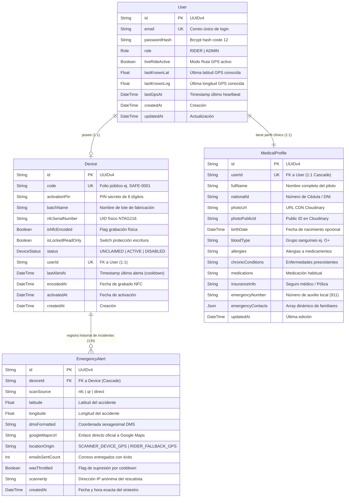

# SAFE — Arquitectura Integral de Base de Datos (Edición 2026)
> **Emergency Medical & Real-Time GPS Ledger for Riders**  
> **Motor RDBMS:** PostgreSQL 16+ (Neon Serverless / Supabase / AWS RDS) · Pooling vía PgBouncer  
> **ORM & Modelado:** Prisma ORM v6+ · Esquema Fuertemente Tipado con Índices B-Tree  
> **Regla de Ingeniería:** Límite estricto < 500 líneas por archivo · Cero mocks · Relación Estricta 1:1.

---

## 1. Visión y Topología de Datos

La base de datos de **SAFE** está diseñada con tres objetivos arquitectónicos prioritarios:
1. **Velocidad de Lectura Sub-Milisegundo en Emergencia:** Durante un accidente en carretera, la consulta de la ficha médica por código de casco (`Device.code = 'SAFE-0001'`) debe resolverse en menos de 5ms mediante índices únicos B-Tree.
2. **Relación Estricta 1:1 (Un Chip = Una Cuenta):** Cada motociclista posee exactamente un kit físico (`Device`), eliminando complejidades multi-dispositivo y garantizando integridad referencial unívoca.
3. **Persistencia Histórica Inmutable de Alertas:** Cada escaneo y despacho de auxilio se registra como una fila de auditoría inmutable en `EmergencyAlert`, capturando coordenadas DMS, origen del sensor y efectividad del envío de correos.

---

## 2. Diagrama Entidad-Relación Oficial (Mermaid ERD)



---

## 3. Esquema Completo de Prisma (`prisma/schema.prisma`)

```prisma
datasource db {
  provider = "postgresql"
  url      = env("DATABASE_URL")
}

generator client {
  provider = "prisma-client-js"
}

enum Role {
  RIDER
  ADMIN
}

enum DeviceStatus {
  UNCLAIMED // Kit virgen de fábrica: redirige a /activate/[code]
  ACTIVE    // Kit activado: redirige SIEMPRE a /emergency/[code]
  DISABLED  // Dado de baja por pérdida, robo o reemplazo
}

model User {
  id             String          @id @default(uuid())
  email          String          @unique
  passwordHash   String
  role           Role            @default(RIDER)

  // Relación 1:1 estricta con el dispositivo del casco
  device         Device?
  medicalProfile MedicalProfile?

  // Estado del Modo Ruta GPS (cuando el piloto sale a rodar)
  liveRideActive Boolean         @default(false)
  lastKnownLat   Float?
  lastKnownLng   Float?
  lastGpsAt      DateTime?

  createdAt      DateTime        @default(now())
  updatedAt      DateTime        @updatedAt

  @@index([email])
}

model Device {
  id                String           @id @default(uuid())
  code              String           @unique // Folio público impreso y grabado en NFC
  activationPin     String                   // PIN confidencial de 6 dígitos
  batchName         String                   // Nombre del lote de fabricación en tira
  
  // Metadatos físicos del chip NXP NTAG216
  nfcSerialNumber   String?                  // UID hexadecimal ej. "04:D4:F1:34:C2:2A:81"
  isNfcEncoded      Boolean          @default(false)
  isLockedReadOnly  Boolean          @default(false)
  status            DeviceStatus     @default(UNCLAIMED)

  // Vinculación única 1:1 con el usuario
  userId            String?          @unique
  user              User?            @relation(fields: [userId], references: [id], onDelete: SetNull)

  // Control de alertas y cooldown anti-spam
  alerts            EmergencyAlert[]
  lastAlertAt       DateTime?                // Timestamp de última alerta despachada
  encodedAt         DateTime?
  activatedAt       DateTime?
  createdAt         DateTime         @default(now())

  @@index([code])
  @@index([status])
}

model MedicalProfile {
  id                String   @id @default(uuid())
  userId            String   @unique
  user              User     @relation(fields: [userId], references: [id], onDelete: Cascade)

  // Identificación y Multimedia
  fullName          String
  nationalId        String   // Cédula o Documento Nacional de Identidad
  photoUrl          String   // URL optimizada en CDN Cloudinary (600x600 crop rostro)
  photoPublicId     String?  // ID público de Cloudinary para reemplazo limpio
  birthDate         DateTime?

  // Datos Clínicos Vitales
  bloodType         String   // "O+", "O-", "A+", "A-", "B+", "B-", "AB+", "AB-", "DESCONOCIDO"
  allergies         String   @default("Ninguna conocida")
  chronicConditions String   @default("Ninguna declarada")
  medications       String   @default("Ninguno")
  insuranceInfo     String?  // Entidad promotora de salud / Seguro de accidentes
  emergencyNumber   String   @default("911")

  // Contactos de Emergencia Ilimitados (Almacenados en JSONB de alto rendimiento)
  emergencyContacts Json     @default("[]")

  updatedAt         DateTime @updatedAt

  @@index([userId])
}

model EmergencyAlert {
  id              String   @id @default(uuid())
  deviceId        String
  device          Device   @relation(fields: [deviceId], references: [id], onDelete: Cascade)

  scanSource      String   // "nfc" | "qr" | "direct"
  latitude        Float
  longitude       Float
  dmsFormatted    String   // Ej. "2°10'06.9\"S 79°27'10.6\"W"
  googleMapsUrl   String   // URL oficial de Google Maps con pin exacto
  locationOrigin  String   // "SCANNER_DEVICE_GPS" | "RIDER_FALLBACK_GPS"
  emailsSentCount Int      @default(0)
  wasThrottled    Boolean  @default(false) // True si se suprimió el correo por ventana de 3 min
  scannerIp       String?

  createdAt       DateTime @default(now())

  @@index([deviceId, createdAt(sort: Desc)])
}
```

---

## 4. Estructura y Validación del Campo JSON `emergencyContacts`

Para permitir **contactos de emergencia ilimitados** sin crear tablas hijas adicionales que ralenticen las consultas de emergencia, la columna `emergencyContacts` se define como `Json` (PostgreSQL `JSONB` nativo).

### Contrato TypeScript y Esquema Zod:
```typescript
export interface EmergencyContactPayload {
  id: string;          // UUIDv4 generado en cliente
  name: string;        // Nombre completo del familiar o allegado
  relation: string;    // Parentesco: "Madre", "Esposa", "Hermano", "Amigo", etc.
  phone: string;       // Teléfono con código de país para llamada directa y WhatsApp
  email: string;       // Correo para despacho automático de la alerta de Google Maps
  isPrimary?: boolean; // Contacto principal de contacto telefónico
}
```

---

## 5. Estrategia de Índices y Rendimiento

1. **`Device.code` (Índice Único B-Tree):**
   - El router `/r/[code]` ejecuta `SELECT * FROM "Device" WHERE "code" = $1`. El índice único garantiza un tiempo de búsqueda $O(\log N)$, resolviendo la consulta en < 2ms.
2. **`Device.status` (Índice B-Tree):**
   - Acelera los reportes de administración en `/admin` para filtrar lotes de chips `UNCLAIMED` pendientes de grabado físico.
3. **`EmergencyAlert(deviceId, createdAt DESC)` (Índice Compuesto):**
   - Optimiza la consulta del cálculo de cooldown anti-spam en `/api/emergency/alert`:
     `SELECT * FROM "EmergencyAlert" WHERE "deviceId" = $1 ORDER BY "createdAt" DESC LIMIT 1`.
4. **Pool de Conexiones:**
   - En Neon / Supabase Serverless, se utiliza la URL con `?pgbouncer=true` y un pool de 10 a 20 conexiones concurrentes, evitando el agotamiento de sockets en Next.js App Router.

---

## 6. Transacciones Atómicas y Ciclo de Vida de los Datos

* **Activación de Kit (`$transaction`):** La creación del `User`, la inserción del `MedicalProfile` y la mutación de `Device` de `UNCLAIMED` a `ACTIVE` se ejecutan dentro de una transacción atómica `READ COMMITTED`. Si la subida de foto o el hashing falla, la base de datos revierte completamente sin dejar usuarios huérfanos.
* **Eliminación y Protección de Datos (Habeas Data / GDPR):**
  - Si un usuario elimina su cuenta desde el `/dashboard`, la relación `onDelete: Cascade` en `MedicalProfile` purga de inmediato sus datos clínicos y contactos.
  - La relación con `Device` aplica `onDelete: SetNull`, permitiendo que el hardware físico pueda ser reciclado o auditado en el panel de administración sin exponer datos personales del conductor anterior.

---

## 7. Estrategia de Migraciones, Semillero (`seed.ts`) y Resiliencia

1. **Flujo de Migraciones con Prisma Migrate:**
   - En desarrollo: `npx prisma migrate dev --name <nombre_descriptivo>` genera archivos SQL auditables en `prisma/migrations/`.
   - En producción (CI/CD): `npx prisma migrate deploy` aplica las migraciones pendientes sin prompts interactivos.
2. **Semillero de Inicialización (`prisma/seed.ts`):**
   - Script ejecutable (`npx prisma db seed`) que verifica si existe el usuario Administrador maestro configurado en `.env` (`ADMIN_MASTER_KEY` / `ADMIN_EMAIL`).
   - Si no existe, lo crea con `Role.ADMIN` y contraseña con hash Bcrypt coste 12, permitiendo acceso inmediato a `/admin` en despliegues nuevos.
3. **Zonas Horarias e Inmutabilidad de Timestamps:**
   - Todas las columnas `DateTime` se almacenan en UTC (`TIMESTAMPTZ` nativo de PostgreSQL). La conversión a zona horaria local se realiza exclusivamente en el cliente del rescatista o familiar.
4. **Respaldos y Tolerancia a Fallos:**
   - Copias de seguridad automáticas diarias vía Neon/Supabase (Point-in-Time Recovery - PITR hasta 7 días).
   - Reintentos automáticos en Prisma Client ante desconexiones transitorias de red en conexiones Serverless.

