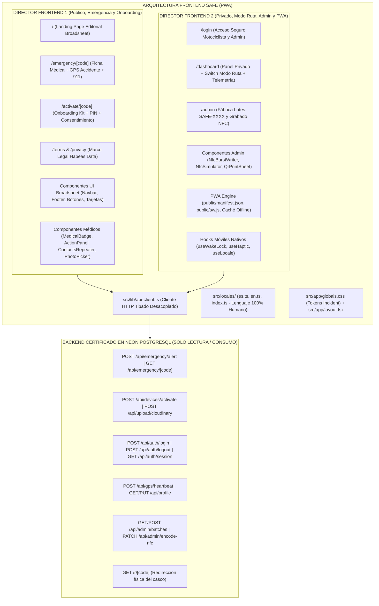

# SAFE — Arquitectura Integral de Frontend y Experiencia Móvil PWA (Edición 2026)
> **Emergency Medical & Real-Time GPS Ledger for Riders**  
> **Framework:** Next.js 15 (App Router / React 19 / Client Components con TypeScript estricto)  
> **Sistema de Diseño:** *Incident — Technical broadsheet on concrete* (`#efefef`, `#000000`, `#ffffff`, `#f25533`, `#ff492c`, `#f1641e`)  
> **Regla de Integración con Backend:** 100% acoplado a los Route Handlers certificados en `src/app/api/*`. **PROHIBIDO MODIFICAR EL BACKEND**.  
> **Límite Estricto:** < 500 líneas físicas por archivo · Cero mocks o datos demo · Cabeceras y comentarios en Español.

---

## 1. Visión General de la Experiencia de Usuario y Topología

El frontend de **SAFE** es una aplicación web progresiva (PWA) de alto rendimiento, optimizada para responder instantáneamente en dos escenarios críticos:
1. **Escenario de Rescate Vial (Público):** Pantalla de emergencia bajo luz solar directa, captura inmediata de geolocalización del accidente, llamada a servicios de auxilio y consulta de ficha médica protegida.
2. **Escenario de Carretera y Operación (Privado):** Panel del motociclista con *Modo Ruta* (telemetría satelital en vivo cada 15-30s y pantalla siempre activa con Screen WakeLock) y panel administrativo para la codificación física de tiras de cascos NFC.

---

## 2. Los Dos Dominios de Construcción Frontend

Para garantizar ejecución autónoma y simultánea sin colisiones, el frontend se particiona estrictamente en dos territorios:

### 🚨 DOMINIO 1: Frontend Público, Emergencia en Carretera & Onboarding (Director 1)
* **Objetivo:** Garantizar que cualquier transeúnte, paramédico o comprador de un casco pueda auxiliar o activar su kit sin fricción técnica.
* **Componentes visuales de rescate:** Máximo contraste tipográfico para legibilidad bajo sol brillante, botones de acción inmediata (Llamar 911, Abrir WhatsApp SOS con ubicación en vivo), selector facial y repetidor de contactos familiares.
* **Rutas bajo su custodia:**
  * `src/app/page.tsx`
  * `src/app/emergency/[code]/page.tsx`
  * `src/app/activate/[code]/page.tsx`
  * `src/app/terms/page.tsx` y `src/app/privacy/page.tsx`
  * `src/components/ui/*`
  * `src/components/medical/*`
* **Endpoints que consume:**
  * `GET /api/emergency/[code]` (Obtiene ficha médica y contactos).
  * `POST /api/emergency/alert` (Despacha auxilio, GPS y correos Gmail).
  * `POST /api/devices/activate` (Activa kit con PIN y crea cuenta).
  * `POST /api/upload/cloudinary` (Sube foto de perfil recortada a 600x600).

---

### 🛡️ DOMINIO 2: Frontend Privado, Modo Ruta, Fábrica Admin & PWA (Director 2)
* **Objetivo:** Proveer al motociclista su centro de control durante rodadas en carretera y al administrador la fábrica de stickers y tarjetas NFC.
* **Modo Ruta Móvil:** Conexión continua con la API Geolocation de HTML5, telemetría cada 15-30s hacia `/api/gps/heartbeat`, activación de `Screen WakeLock API` para evitar que el teléfono se apague en el manubrio de la moto, y feedback háptico.
* **Fábrica de Lotes y Grabado NFC:** Grabador Web NFC API para escribir `https://safe.app/r/SAFE-XXXX` en los chips físicos, con simulador interactivo para pruebas en PC.
* **Rutas y Servicios bajo su custodia:**
  * `src/app/login/page.tsx`
  * `src/app/dashboard/page.tsx`
  * `src/app/admin/page.tsx`
  * `src/components/admin/*`
  * `public/manifest.json`, `public/sw.js`, `public/icons/*`
  * `src/hooks/*` (`useWakeLock.ts`, `useHaptic.ts`, `useLocale.ts`)
  * `src/app/globals.css`, `src/app/layout.tsx`
  * `src/locales/*`
  * `src/lib/api-client.ts`
* **Endpoints que consume:**
  * `POST /api/auth/login` y `POST /api/auth/logout`
  * `GET /api/auth/session`
  * `POST /api/gps/heartbeat`
  * `GET/PUT /api/profile`
  * `GET/POST /api/admin/batches`
  * `PATCH /api/admin/encode-nfc`

---

## 3. Principio de Cero Mocks y Acoplamiento Dinámico Total

1. **Fin de la fase de prototipado:** Todos los componentes y páginas deben conectarse a los route handlers reales a través de `src/lib/api-client.ts`.
2. **Sin datos estáticos en código:** No se permiten constantes de conductores de prueba (`fullName: "Conductor Protegido"` o contactos falsos). Si una petición está cargando, se muestra un esqueleto de carga (*skeleton*) con diseño Incident; si falla, se despliega un mensaje humano en el idioma activo.
3. **Manejo de Errores Humanos:** Se prohíbe exponer errores crudos de red o código (`Error 500`, `P2002`). Se usan exclusivamente las cadenas del diccionario de `src/locales/`.

---

## 4. Reglas de Convivencia y No-Colisión

1. **Prohibido tocar `src/app/api/*`, `prisma/*` y `src/lib/auth.ts`, `db.ts`, `env.ts`:** El backend ya está certificado en PostgreSQL Neon y no debe sufrir modificaciones.
2. **Límite físico estricto:** Máximo 500 líneas físicas por archivo.
3. **Compilación continua:** Antes de reportar avance, cada director debe validar con `npx tsc --noEmit`.
