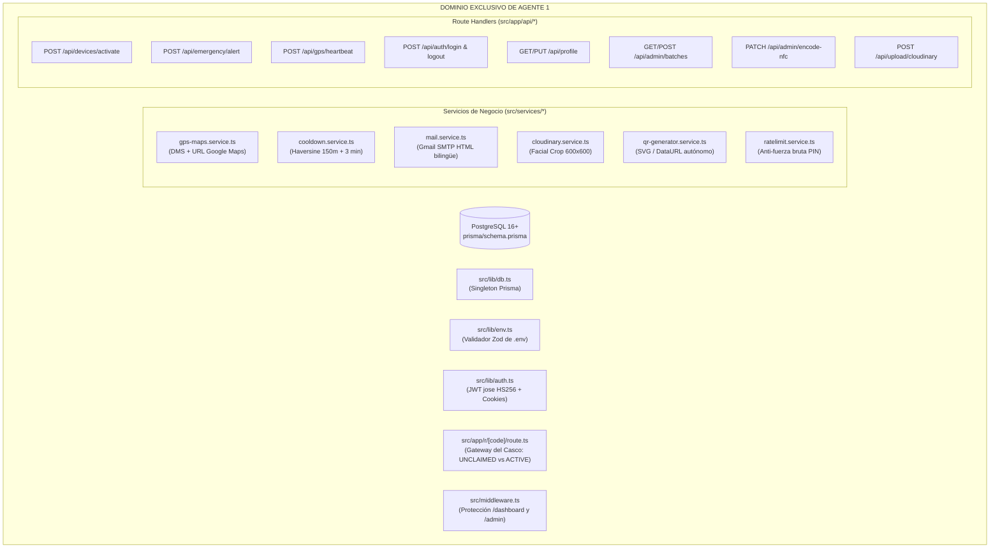

# SAFE — Plan de Arquitectura y Construcción: AGENTE 1
> **Rol:** Ingeniero de Backend, Persistencia Relacional y Servicios Nucleares  
> **Asignación:** Agente de IA #1  
> **Dominio Exclusivo:** Base de Datos (PostgreSQL + Prisma) · Servicios de Negocio · API Route Handlers · Edge Middleware · Gateway del Casco  
> **Regla de Independencia:** 100% autónomo. No depende del frontend ni de la UI para construir, probar y certificar sus endpoints.  
> **Límite Estricto:** Menos de 500 líneas físicas por archivo · Cabeceras y comentarios en Español.

---

## 1. Misión y Responsabilidad de Agente 1

El **Agente 1** es el responsable absoluto de la capa de datos, seguridad, cálculo geodésico y despacho de comunicaciones de **SAFE**. Su objetivo es entregar un servidor robusto, compilable y verificado que responda con latencias inferiores a 80ms a los escaneos de emergencia.



---

## 2. Inventario de Archivos Bajo Custodia Exclusiva (Agente 1)

> [!CAUTION]
> **REGLA DE CONCURRENCIA:** El Agente 2 tiene **estrictamente prohibido editar o alterar** los archivos de esta lista. Cualquier cambio de contrato debe solicitarse a través de `docs/LIVE_ARCHITECTURE_LEDGER.md`.

1. `prisma/schema.prisma`: Modelos `User`, `Device`, `MedicalProfile`, `EmergencyAlert` y enums.
2. `prisma/seed.ts`: Semillero para inicializar el SuperAdmin maestro (`ADMIN_MASTER_KEY`).
3. `src/middleware.ts`: Guardián de rutas privadas (`/dashboard`, `/admin`) y cabeceras de seguridad.
4. `src/lib/env.ts`: Validador estricto de variables `.env` al arrancar el servidor.
5. `src/lib/db.ts`: Instancia Singleton de Prisma Client con reconexión automática.
6. `src/lib/auth.ts`: Firmado y verificación de tokens JWT con librería `jose` (HS256).
7. `src/lib/api-response.ts`: Respuestas HTTP JSON canónicas (`successResponse`, `errorResponse`).
8. `src/lib/schemas/*.ts`: Esquemas Zod para activación, alertas, perfiles y administración.
9. `src/services/gps-maps.service.ts`: Conversión decimal a DMS y generador de URL Google Maps.
10. `src/services/cooldown.service.ts`: Fórmula de Haversine y ventana anti-spam de 3 min (>150m).
11. `src/services/mail.service.ts`: Cliente Nodemailer y plantilla HTML Incident bilingüe.
12. `src/services/cloudinary.service.ts`: SDK Cloudinary v2 centrado en facciones (600x600).
13. `src/services/qr-generator.service.ts`: Generador vectorial local de códigos QR en memoria.
14. `src/services/ratelimit.service.ts`: Límite de 5 intentos fallidos en PIN y login cada 15 min.
15. `src/app/r/[code]/route.ts`: Gateway del casco físico (redirige a `/activate` o `/emergency`).
16. `src/app/api/**/route.ts`: Todos los Route Handlers de la API.

---

## 3. Contratos de Salida Congelados (Para que Agente 2 consuma sin esperarte)

El Agente 1 se compromete a entregar las respuestas JSON bajo este formato inmutable:

### 3.1. Respuesta Exitosa Canónica:
```typescript
export interface ApiResponseSuccess<T> {
  success: true;
  data: T;
}
```

### 3.2. Respuesta de Error Canónica:
```typescript
export interface ApiResponseError {
  success: false;
  error: {
    code: "VALIDATION_ERROR" | "UNAUTHORIZED" | "FORBIDDEN" | "NOT_FOUND" | "RATE_LIMIT" | "SERVER_ERROR";
    message: string; // Mensaje humano amigable (Cero tecnicismos)
    details?: unknown;
  };
}
```

### 3.3. Contratos Específicos de Endpoints:
* **`POST /api/devices/activate`** → `{ success: true, data: { redirect: "/dashboard" } }` + Cookie `safe_session`.
* **`POST /api/emergency/alert`** → `{ success: true, data: { alertId: string, dmsFormatted: string, googleMapsUrl: string, emailsSentCount: number, wasThrottled: boolean } }`.
* **`POST /api/gps/heartbeat`** → `{ success: true, data: { recordedAt: string } }`.
* **`GET /api/profile`** → `{ success: true, data: { fullName, nationalId, bloodType, allergies, chronicConditions, medications, insuranceInfo, emergencyContacts } }`.
* **`POST /api/admin/batches`** → `{ success: true, data: { batchName: string, devices: Array<{ code: string, activationPin: string }> } }`.
* **`POST /api/upload/cloudinary`** → `{ success: true, data: { photoUrl: string, photoPublicId: string } }`.

---

## 4. Procedimiento de Verificación Automatizada Independiente

El Agente 1 no necesita abrir un navegador ni esperar pantallas visuales. Certifica su trabajo de forma 100% aislada ejecutando:

1. **Prueba de Compilación TypeScript Estricta:**
   `npx tsc --noEmit` (Cero errores de tipos en rutas, esquemas o servicios).
2. **Generación del Cliente Prisma:**
   `npx prisma generate` (Cliente generado y sincronizado con PostgreSQL).
3. **Validación de Servicios Matemáticos y Geodésicos:**
   Script de verificación en `scratch/test-backend-services.ts`:
   - Validar que `decimalToDMS(2.168583, -79.452944)` retorne exactamente `2°10'06.9"N 79°27'10.6"W`.
   - Validar que Haversine retorne la distancia correcta en metros entre dos coordenadas.
   - Validar que la ventana de cooldown de 3 minutos suprima el envío de correos si $\Delta \text{distancia} < 150m$.
4. **Registro en el Ledger:**
   Registrar cada archivo creado con su conteo de líneas en [`docs/LIVE_ARCHITECTURE_LEDGER.md`](file:///c:/Users/HP/OneDrive/Desktop/safe/docs/LIVE_ARCHITECTURE_LEDGER.md).
