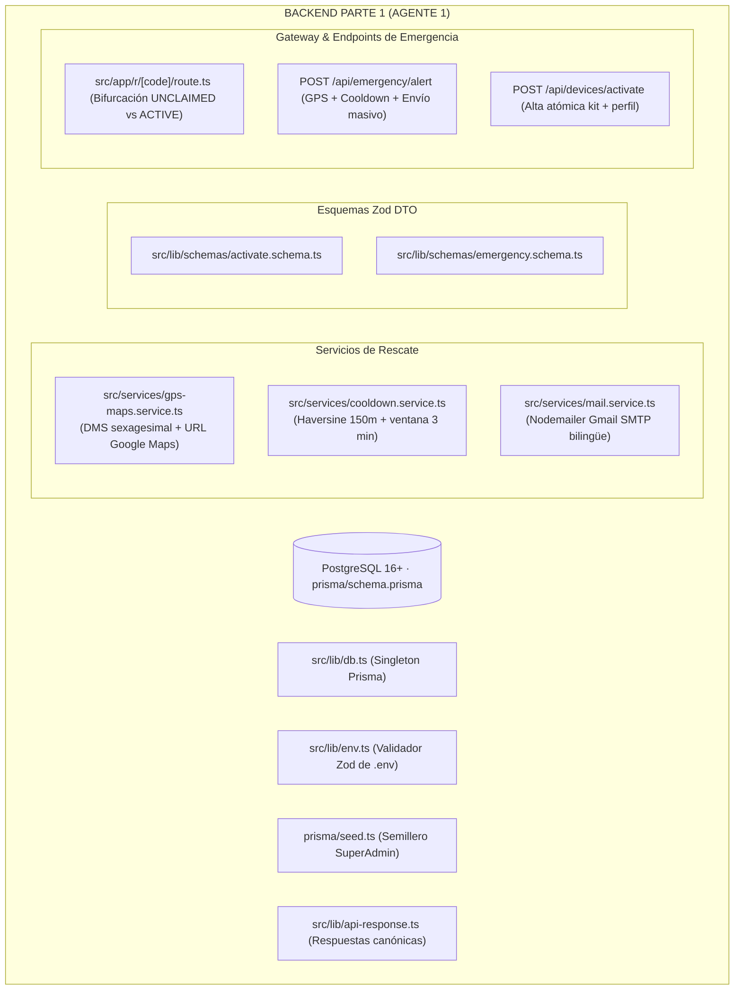

# SAFE — Plan de Arquitectura Backend: AGENTE 1 (Parte 1 de 2)
> **Rol:** Director de Backend — Parte 1: Base de Datos, Gateway del Casco y Despacho de Emergencia  
> **Dominio Exclusivo:** Persistencia PostgreSQL · Prisma ORM · Gateway `/r/[code]` · Motor de Emergencia y Rescate  
> **Regla de Independencia:** 100% autónomo. No toca frontend ni depende de la Parte 2 para compilar y validar.  
> **Límite Estricto:** Menos de 500 líneas por archivo · Cabeceras y comentarios en Español · Cero mocks.

---

## 1. Misión y Territorio Exclusivo de Agente 1 (Backend Parte 1)

El **Agente 1** construye el corazón de datos y el flujo de emergencia vital del casco:

---

## 2. Inventario de Archivos Bajo Custodia de Agente 1

> [!CAUTION]
> **LÍMITE DE CUSTODIA:** El Agente 2 tiene **estrictamente prohibido modificar estos archivos**:

1. `prisma/schema.prisma`: Modelos `User`, `Device`, `MedicalProfile`, `EmergencyAlert` y enums.
2. `prisma/seed.ts`: Semillero inicial de base de datos.
3. `src/lib/env.ts`: Validación de variables de entorno al arranque.
4. `src/lib/db.ts`: Instancia Singleton de Prisma Client.
5. `src/lib/api-response.ts`: Helpers estandarizados de respuesta HTTP (`successResponse`, `errorResponse`).
6. `src/lib/schemas/activate.schema.ts`: Esquema Zod de activación de kit con PIN de 6 dígitos.
7. `src/lib/schemas/emergency.schema.ts`: Esquema Zod de recepción de coordenadas del accidente.
8. `src/services/gps-maps.service.ts`: Conversión decimal a DMS sexagesimal y URL de Google Maps.
9. `src/services/cooldown.service.ts`: Cálculo geodésico Haversine y regla de 3 min / 150m.
10. `src/services/mail.service.ts`: Cliente SMTP de Gmail y despacho de alertas bilingües.
11. `src/app/r/[code]/route.ts`: Gateway de redirección del casco físico (HTTP 307).
12. `src/app/api/emergency/alert/route.ts`: Endpoint crítico de rescate y despacho.
13. `src/app/api/devices/activate/route.ts`: Endpoint de activación de kit virgen.
14. `src/app/api/emergency/[code]/route.ts`: Endpoint público de consulta de ficha médica protegida para auxilio vial.

---

## 3. Verificación Automatizada Independiente de Agente 1
- Ejecutar `npx prisma generate`.
- Ejecutar `npx tsc --noEmit`.
- Validar con script de prueba en memoria (`scratch/test-parte1.ts`) que `gps-maps`, `cooldown` y los endpoints de activación y alerta funcionen sin errores.
- Actualizar `docs/LIVE_ARCHITECTURE_LEDGER.md`.
