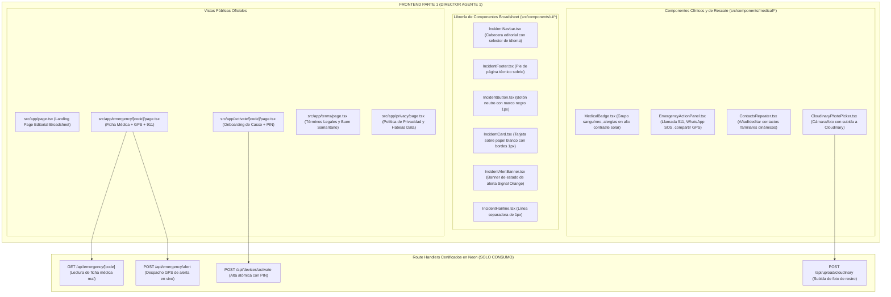

# SAFE — Plan de Arquitectura Frontend: AGENTE 1 (Público, Emergencia y Onboarding)
> **Rol:** Director de Frontend — Parte 1: Frente Vial, Emergencia en Carretera y Activación de Kits  
> **Dominio Exclusivo:** Vistas Públicas (`/`, `/emergency/[code]`, `/activate/[code]`, `/terms`, `/privacy`) · Componentes UI Broadsheet · Componentes Médicos de Rescate  
> **Regla de Integración:** 100% acoplado a los endpoints del Backend ya certificado. **PROHIBIDO TOCAR CÓDIGO DE BACKEND**.  
> **Límite Estricto:** Menos de 500 líneas físicas por archivo · Cabeceras y comentarios en Español · Cero mocks o datos estáticos de demostración.

---

## 1. Misión y Territorio Exclusivo de Agente 1 (Frontend Parte 1)

El **Agente 1** construye la experiencia visual pública más crítica de la plataforma: la pantalla que salva vidas en carretera cuando un rescatista escanea el casco de un motociclista accidentado, el portal de activación de nuevos kits físicos y la portada institucional.

---

## 2. Inventario de Archivos Bajo Custodia Exclusiva (Frontend Parte 1)

> [!CAUTION]
> **LÍMITE DE CUSTODIA:** El Director Frontend 2 y otros agentes tienen **estrictamente prohibido modificar estos archivos**:

1. `src/app/page.tsx`: Landing page broadsheet con estadísticas de respuesta, explicación del chip y accesos directos.
2. `src/app/emergency/[code]/page.tsx`: Ficha médica de rescate; consume `GET /api/emergency/[code]`, captura GPS del navegador al montar y dispara `POST /api/emergency/alert`.
3. `src/app/activate/[code]/page.tsx`: Formulario de activación de 1ra vez; valida PIN, captura datos clínicos y consentimiento, y despacha a `POST /api/devices/activate`.
4. `src/app/terms/page.tsx`: Términos de rescate y cláusula del Buen Samaritano bilingüe.
5. `src/app/privacy/page.tsx`: Política de tratamiento de datos médicos sensibles (Habeas Data).
6. `src/components/ui/IncidentNavbar.tsx`: Barra superior con selector de idioma instantáneo.
7. `src/components/ui/IncidentFooter.tsx`: Pie de página editorial con enlaces legales y estado del sistema.
8. `src/components/ui/IncidentButton.tsx`: Botón neutro interactivo con feedback háptico.
9. `src/components/ui/IncidentCard.tsx`: Contenedor tipo ficha sobre papel blanco.
10. `src/components/ui/IncidentAlertBanner.tsx`: Indicador visual de alerta despachada y ventana anti-spam.
11. `src/components/ui/IncidentHairline.tsx`: Separador gráfico de 1px.
12. `src/components/medical/MedicalBadge.tsx`: Insignia de alta visibilidad para grupo sanguíneo y alergias.
13. `src/components/medical/EmergencyActionPanel.tsx`: Botonera táctil de 44x44px mínimos para 911 y WhatsApp.
14. `src/components/medical/ContactsRepeater.tsx`: Repetidor dinámico de contactos de emergencia.
15. `src/components/medical/CloudinaryPhotoPicker.tsx`: Componente de captura de foto con recorte centrado.

---

## 3. Principio de Conexión Real al Backend (Erradicación de Mocks)

* **En `src/app/emergency/[code]/page.tsx`:**  
  Eliminar cualquier estado inicial de demostración (`fullName: "Conductor Protegido"`). La vista debe arrancar en estado de carga (*skeleton* broadsheet) y hacer fetch a `GET /api/emergency/[code]`. Si el chip está inactivo o no existe, renderizar el estado de error humano en el idioma seleccionado.
* **En `src/app/activate/[code]/page.tsx`:**  
  Conectar directamente con `POST /api/devices/activate`. Al recibir `{ success: true, redirect: "/dashboard" }`, redirigir al panel del conductor.
* **En `src/components/medical/CloudinaryPhotoPicker.tsx`:**  
  Subir el archivo base64 o multipart directamente a `POST /api/upload/cloudinary` y recibir `{ photoUrl, photoPublicId }`.

---

## 4. Verificación Automatizada Independiente de Agente 1
1. Ejecutar `npx tsc --noEmit` para verificar tipado estricto.
2. Comprobar que ningún archivo exceda las 500 líneas físicas.
3. Actualizar `docs/LIVE_ARCHITECTURE_LEDGER.md` tras completar cada vista o componente.
