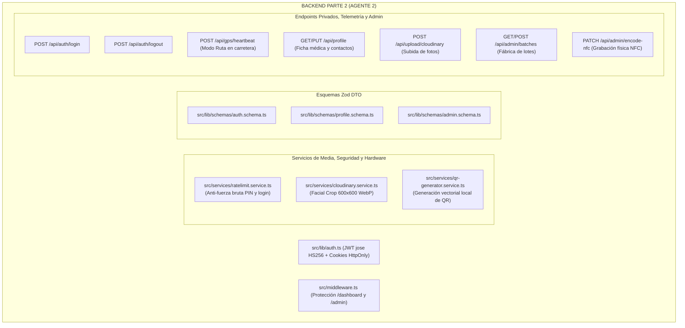

# SAFE — Plan de Arquitectura Backend: AGENTE 2 (Parte 2 de 2)
> **Rol:** Director de Backend — Parte 2: Autenticación, Telemetría en Ruta, Fábrica Admin y Media  
> **Dominio Exclusivo:** Autenticación JWT `jose` · Edge Middleware · Telemetría GPS en Vivo · Cloudinary SDK · Fábrica NFC / QR Admin  
> **Regla de Independencia:** 100% autónomo. No toca frontend ni depende de la Parte 1 para compilar y validar.  
> **Límite Estricto:** Menos de 500 líneas por archivo · Cabeceras y comentarios en Español · Cero mocks.

---

## 1. Misión y Territorio Exclusivo de Agente 2 (Backend Parte 2)

El **Agente 2** construye el sistema de seguridad, control de sesiones, telemetría de ruta del motociclista y la fábrica de hardware para el administrador:

---

## 2. Inventario de Archivos Bajo Custodia de Agente 2

> [!CAUTION]
> **LÍMITE DE CUSTODIA:** El Agente 1 tiene **estrictamente prohibido modificar estos archivos**:

1. `src/lib/auth.ts`: Firmado y verificación de JWT con `jose` y lectura/escritura de cookies `HttpOnly`.
2. `src/middleware.ts`: Guardián de rutas y cabeceras de seguridad HTTP.
3. `src/services/ratelimit.service.ts`: Control de fuerza bruta mediante ventana deslizante (máximo 5 fallos cada 15 min).
4. `src/services/cloudinary.service.ts`: SDK Cloudinary v2 para optimización facial de fotos (600x600px).
5. `src/services/qr-generator.service.ts`: Renderizador de códigos QR en memoria con `qrcode`.
6. `src/lib/schemas/auth.schema.ts`: Esquemas Zod para credenciales de acceso.
7. `src/lib/schemas/profile.schema.ts`: Esquema Zod de actualización de perfil médico y contactos.
8. `src/lib/schemas/admin.schema.ts`: Esquemas Zod para generación de lotes y grabado NFC.
9. `src/app/api/auth/login/route.ts`: Endpoint de login con contraseña y generación de cookie JWT.
10. `src/app/api/auth/logout/route.ts`: Endpoint de revocación inmediata de sesión.
11. `src/app/api/gps/heartbeat/route.ts`: Endpoint de telemetría de posición en carretera para Modo Ruta.
12. `src/app/api/profile/route.ts`: Endpoint de consulta y edición de ficha médica y contactos.
13. `src/app/api/upload/cloudinary/route.ts`: Endpoint de subida de fotos de rostro a Cloudinary.
14. `src/app/api/admin/batches/route.ts`: Endpoint de generación de lotes secuenciales (`SAFE-XXXX`) y PINs.
15. `src/app/api/admin/encode-nfc/route.ts`: Endpoint de confirmación de grabado NFC y switch de bloqueo.
16. `src/app/api/auth/session/route.ts`: Endpoint de verificación de sesión activa y usuario autenticado.

---

## 3. Verificación Automatizada Independiente de Agente 2
- Ejecutar `npx tsc --noEmit`.
- Validar con script de prueba en memoria (`scratch/test-parte2.ts`) que `auth.ts`, `ratelimit`, `qr-generator` y los endpoints de login, telemetría y admin funcionen sin errores.
- Actualizar `docs/LIVE_ARCHITECTURE_LEDGER.md`.
