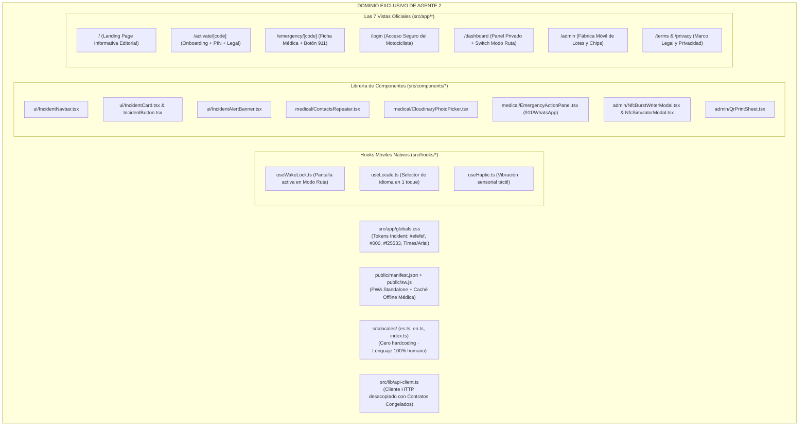

# SAFE — Plan de Arquitectura y Construcción: AGENTE 2
> **Rol:** Ingeniero de Frontend, Experiencia Móvil Nativa y PWA  
> **Asignación:** Agente de IA #2  
> **Dominio Exclusivo:** Sistema de Diseño Incident · Vistas Públicas y Paneles · PWA & Service Worker Offline · Componentes UI · Bilingüismo ES/EN · Hooks Móviles  
> **Regla de Independencia:** 100% autónomo. Consume los contratos congelados de API. No depende de tener la base de datos PostgreSQL local corriendo para diseñar, compilar y certificar la UI.  
> **Límite Estricto:** Menos de 500 líneas físicas por archivo · Cabeceras y comentarios en Español.

---

## 1. Misión y Responsabilidad de Agente 2

El **Agente 2** es el responsable absoluto de la identidad visual, la ergonomía táctil en carretera y la experiencia de usuario de **SAFE**. Su objetivo es construir una interfaz editorial de alta autoridad técnica bajo el sistema **Incident (Technical broadsheet on concrete)**, garantizando que el 100% de los textos sean bilingües (`es` y `en`), sin tecnicismos en pantalla, y con sensación nativa de aplicación móvil.

---

## 2. Inventario de Archivos Bajo Custodia Exclusiva (Agente 2)

> [!CAUTION]
> **REGLA DE CONCURRENCIA:** El Agente 1 tiene **estrictamente prohibido editar o alterar** los archivos de esta lista. Cualquier necesidad de interfaz se comunica vía `docs/LIVE_ARCHITECTURE_LEDGER.md`.

1. `src/app/globals.css`: Configuración `@theme` de Tailwind v4 y variables CSS Incident.
2. `src/app/layout.tsx`: Layout raíz con metadata PWA, viewport cover y fuentes.
3. `public/manifest.json`: Metadatos de instalación standalone e iconos.
4. `public/sw.js`: Service worker para caché offline de la vista de emergencia.
5. `src/locales/index.ts`, `src/locales/es.ts`, `src/locales/en.ts`: Diccionarios bilingües.
6. `src/hooks/useWakeLock.ts`: Control de suspensión de pantalla en Modo Ruta.
7. `src/hooks/useLocale.ts`: Conmutador dinámico de idioma con persistencia.
8. `src/hooks/useHaptic.ts`: Manejador de vibración táctil para el móvil.
9. `src/lib/api-client.ts`: Cliente de llamadas a la API que consume los contratos de Agente 1.
10. `src/components/ui/*.tsx`: Navbar institucional, botones neutros, tarjetas y banners de alerta.
11. `src/components/medical/*.tsx`: Lista de contactos ilimitados, selector de foto y botones 911/WhatsApp.
12. `src/components/admin/*.tsx`: Modal grabador NFC, simulador de antena para PC y plancha de stickers QR.
13. `src/app/page.tsx`: Landing page institucional broadsheet.
14. `src/app/activate/[code]/page.tsx`: Formulario de activación de 1ra vez.
15. `src/app/emergency/[code]/page.tsx`: Ficha médica de emergencia y receptor GPS.
16. `src/app/login/page.tsx`: Pantalla de inicio de sesión de usuario.
17. `src/app/dashboard/page.tsx`: Panel de control del motociclista.
18. `src/app/admin/page.tsx`: Panel móvil del administrador para generación y codificación.
19. `src/app/terms/page.tsx` y `src/app/privacy/page.tsx`: Páginas legales bilingües.

---

## 3. Estrategia de Autonomía Total (Cliente HTTP Desacoplado)

Para que el **Agente 2** pueda programar, probar en el navegador móvil y finalizar todo el frontend **sin esperar a que Agente 1 termine el backend o conecte PostgreSQL**:

### Archivo Clave: `src/lib/api-client.ts`
El Agente 2 implementa un cliente de transporte que conoce las rutas oficiales y tipos canónicos:
* Si el endpoint responde (`/api/*`), consume los datos reales.
* Si el endpoint aún no está listo o la base de datos está offline durante el desarrollo visual, el cliente puede activar un flag local de desarrollo (`NEXT_PUBLIC_MOCK_API=true`) para simular la respuesta tipada exacta especificada en el contrato de Agente 1, permitiendo probar:
  - El escaneo y visualización de la ficha médica bajo luz solar.
  - El disparo háptico de vibración.
  - La alternancia instantánea entre Español e Inglés.
  - El funcionamiento del grabador y simulador NFC en `/admin`.
  - La instalación PWA en el teléfono.

---

## 4. Directrices Visuales y de Lenguaje Innegociables para Agente 2

1. **Tokens de Color Incident Obligatorios:**
   - Lienzo: `#efefef` (Concrete) | Tarjetas: `#ffffff` (Paper) | Bordes y texto: `#000000` (Ink).
   - Acento de Marca: `#f25533` (Signal Orange) | Alerta crítica: `#ff492c` (Alert Red).
   - **CERO GRADIENTES:** Estética 100% plana y sobria.
   - Botones neutros: Fondo `#efefef`, borde `1px solid #000000`, radio `4px`, padding `6px 12px`, texto en Arial `13px`.
2. **Cero Jerga Técnica:**
   - Prohibido mostrar palabras como `JWT`, `API`, `Prisma`, `Database`, `HTTP 500`, `Payload`.
   - Utilizar únicamente frases humanas: *"Ficha médica de emergencia"*, *"Ubicación satelital en tiempo real"*, *"Aviso automático a familiares"*.
3. **Móvil Nativo:**
   - Botones con área táctil mínima de `44x44px`.
   - Respeto a los márgenes seguros del notch e indicador de inicio (`env(safe-area-inset-*)`).

---

## 5. Procedimiento de Verificación Automatizada Independiente

El Agente 2 certifica su trabajo de forma 100% aislada ejecutando:

1. **Prueba de Compilación y Tipado:**
   `npx tsc --noEmit` (Cero errores de tipos en componentes, hooks o diccionarios).
2. **Prueba de Build de Producción de Next.js:**
   `npm run build` (Todas las 7 rutas estáticas y dinámicas compilan y renderizan sin errores).
3. **Auditoría de Límite de 500 Líneas:**
   Ningún componente ni página excede las 500 líneas físicas (particionamiento en subcomponentes).
4. **Registro en el Ledger:**
   Registrar cada componente y vista creada en [`docs/LIVE_ARCHITECTURE_LEDGER.md`](file:///c:/Users/HP/OneDrive/Desktop/safe/docs/LIVE_ARCHITECTURE_LEDGER.md).
