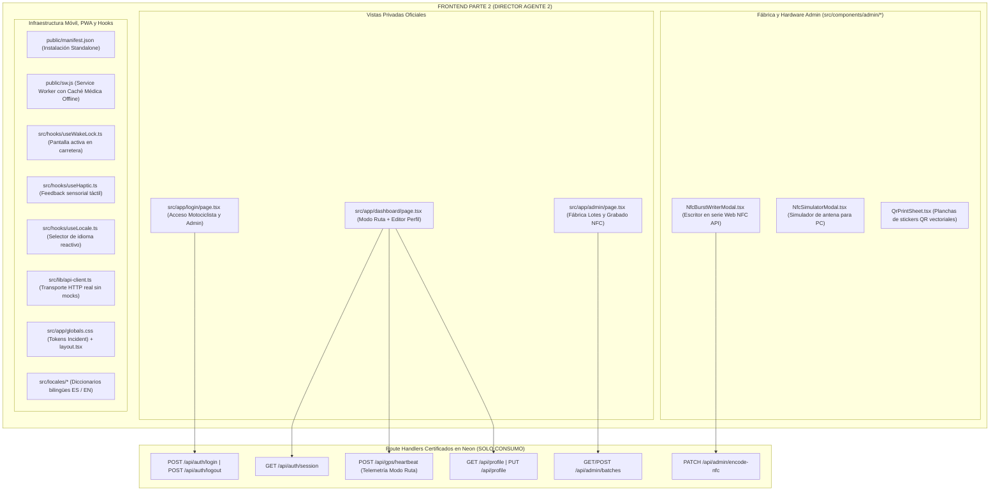

# SAFE — Plan de Arquitectura Frontend: AGENTE 2 (Privado, Modo Ruta, Admin y PWA)
> **Rol:** Director de Frontend — Parte 2: Paneles Privados, Modo Ruta, Fábrica Admin y Experiencia PWA  
> **Dominio Exclusivo:** Vistas Privadas (`/login`, `/dashboard`, `/admin`) · Modo Ruta con Telemetría GPS en Vivo · Grabador NFC y Generador QR · Motor PWA Offline · Hooks Nativos  
> **Regla de Integración:** 100% acoplado a los endpoints del Backend ya certificado. **PROHIBIDO TOCAR CÓDIGO DE BACKEND**.  
> **Límite Estricto:** Menos de 500 líneas físicas por archivo · Cabeceras y comentarios en Español · Cero mocks o datos estáticos de demostración.

---

## 1. Misión y Territorio Exclusivo de Agente 2 (Frontend Parte 2)

El **Agente 2** construye el cerebro operativo del motociclista en ruta y las herramientas físicas del administrador:
* El **Modo Ruta**, que mantiene la pantalla encendida mediante la Screen WakeLock API, enviando telemetría satelital en vivo cada 15-30s hacia `/api/gps/heartbeat`.
* El **Dashboard Privado**, donde el conductor edita su ficha médica real y administra sus contactos mediante `GET/PUT /api/profile`.
* La **Fábrica de Lotes y Grabador NFC en `/admin`**, para generar series `SAFE-XXXX`, imprimir planchas de stickers QR vectoriales y grabar chips físicos mediante Web NFC API (con simulador para PC).
* La **Infraestructura Móvil y PWA**, asegurando que la aplicación sea instalable en teléfonos móviles y cuente con caché offline para situaciones sin señal en carretera.

---

## 2. Inventario de Archivos Bajo Custodia Exclusiva (Frontend Parte 2)

> [!CAUTION]
> **LÍMITE DE CUSTODIA:** El Director Frontend 1 y otros agentes tienen **estrictamente prohibido modificar estos archivos**:

1. `src/app/login/page.tsx`: Pantalla de inicio de sesión con Bcrypt y cookie HttpOnly, con redirección automática a `/dashboard` (Rider) o `/admin` (SuperAdmin).
2. `src/app/dashboard/page.tsx`: Panel privado del motociclista; interruptor de Modo Ruta en vivo, indicador satelital, editor de ficha clínica y logout.
3. `src/app/admin/page.tsx`: Fábrica móvil del administrador; creación de lotes `SAFE-XXXX` y panel de grabado.
4. `src/components/admin/NfcBurstWriterModal.tsx`: Grabador Web NFC API por proximidad móvil.
5. `src/components/admin/NfcSimulatorModal.tsx`: Consola de simulación de contacto NFC para pruebas en navegador de escritorio.
6. `src/components/admin/QrPrintSheet.tsx`: Generador de planchas de stickers QR listas para imprimir en PDF/papel adhesivo.
7. `public/manifest.json`: Configuración PWA (nombre, colores Incident, modo standalone, iconos).
8. `public/sw.js`: Service worker con estrategia Network-First para telemetría y Cache-First para recursos médicos.
9. `src/hooks/useWakeLock.ts`: Hook de prevención de bloqueo de pantalla durante el viaje en moto.
10. `src/hooks/useHaptic.ts`: Hook de vibración táctil para confirmaciones en carretera.
11. `src/hooks/useLocale.ts`: Hook para cambio instantáneo de idioma sin parpadeos.
12. `src/locales/index.ts`, `src/locales/es.ts`, `src/locales/en.ts`: Diccionarios bilingües con lenguaje 100% humano y cero tecnicismos.
13. `src/lib/api-client.ts`: Cliente HTTP centralizado sin fallbacks estáticos ni mocks; consume los Route Handlers reales.
14. `src/app/globals.css`: Tokens de diseño Incident y utilidades mobile-first.
15. `src/app/layout.tsx`: Layout raíz HTML5 con metadata PWA y viewport cover.

---

## 3. Principio de Conexión Real al Backend (Erradicación de Mocks)

* **En `src/lib/api-client.ts`:**  
  Eliminar cualquier bandera `NEXT_PUBLIC_MOCK_API` o respuestas simuladas en memoria. Todas las funciones (`login`, `logout`, `getSession`, `getProfile`, `updateProfile`, `sendHeartbeat`, `createBatch`, `encodeNfc`) deben ejecutar peticiones `fetch()` reales a `/api/*`.
* **En `src/app/dashboard/page.tsx`:**  
  Cargar los datos del conductor real desde `GET /api/profile`. Cuando el interruptor de Modo Ruta esté activo, enviar coordenadas del GPS satelital cada 15-30s a `POST /api/gps/heartbeat` y activar `useWakeLock(true)`.
* **En `src/app/admin/page.tsx`:**  
  Crear lotes reales mediante `POST /api/admin/batches` y actualizar el estado físico del chip mediante `PATCH /api/admin/encode-nfc`.

---

## 4. Verificación Automatizada Independiente de Agente 2
1. Ejecutar `npx tsc --noEmit` para verificar tipado estricto.
2. Comprobar que ningún archivo exceda las 500 líneas físicas.
3. Actualizar `docs/LIVE_ARCHITECTURE_LEDGER.md` tras completar cada vista, hook o componente.
